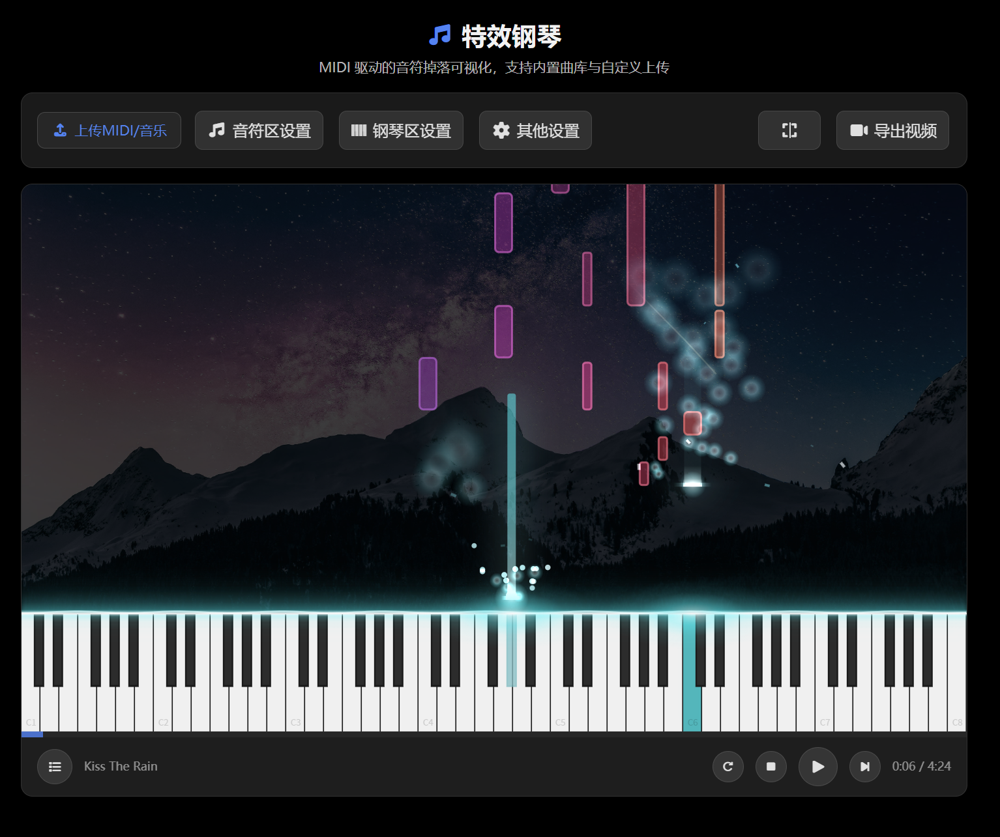

# 🎹 特效钢琴

> MIDI 驱动的音符掉落可视化：燃烧烟雾 / 扩散光环粒子特效，音频实时转 MIDI，1080p MP4 视频导出。  
> 基于 Vue 3 + Vite + Web Audio + WebCodecs，纯前端实现，无需后端，无需注册。

<p align="center">
  
  
  
  
  
  
</p>

<p align="center">
  
</p>

> 🚀 **[在线体验 →](https://tools.lishiyuan.cn/)** &nbsp;|&nbsp; 📖 [English Docs](./README.md)

---

## ✨ 功能

### 核心可视化
- **音符掉落瀑布流**——解析 MIDI 文件，按音高着色，音符方块自上而下掉落至对应的钢琴键位。
- **琴键实时点亮**——接触瞬间琴键高亮，配以可调发光和脉冲效果。
- **内置三首曲目**——卡农、Kiss The Rain、Rivers Flow In You。支持拖拽上传自己的 MIDI 或音频文件。

### 两种接触特效

| 模式 | 效果描述 |
|---|---|
| 🔥 **燃烧烟雾** | 音符接触琴键瞬间点燃：白热前沿自下而上爬过音符本体，未燃区域沿前沿渐隐殆尽。同时释放**解体碎片**（向两侧+上方飞散）、**烟雾团**（上升扩散、激活色着色）、**火星拖尾**（高速白亮粒子）、**接触瞬闪**（白→激活色径向闪光）。燃烧时长等于音符播放时长——长音慢慢燃尽，短音快速消散。 |
| 💫 **扩散光环** | 接触瞬间绽放多彩径向扩散光环（0.6s 渐隐），同时音符方块以激活色持续点亮、带发光描边。画风更干净、更适合氛围向。 |

### 音频转 MIDI
- 上传任意音频文件（mp3 / m4a / wav / ogg / flac），用 **Spotify Basic Pitch** 模型实时转录为 MIDI 并直接加载播放。
- 可调参数：起音阈值、帧阈值、最短音符帧数——方便应对不同音质的音频。
- 无需手动下载转换结果再上传；一步到位。

### MP4 视频导出
- 离屏 Canvas 逐帧渲染 **1920×1080 @ 30fps**，音频由 smplr 离线渲染合成真实琴声。
- 使用 [mediabunny](https://github.com/codler/mediabunny)（基于 WebCodecs）做 H.264 + AAC 封装。
- 支持**流式写盘**（通过 `showSaveFilePicker`，省内存），降级为内存缓冲区下载。
- 实时显示导出进度百分比和预计剩余时间。

### 可定制项
- **音符颜色**——激活色自由选色。
- **钢琴键颜色**——白键 / 黑键 各可独立设置激活态与未激活态颜色。
- **发光与不透明度**——音符发光（0–240px）、音符不透明度（10%–100%）、钢琴发光、钢琴不透明度，各自独立拖拽调节。
- **分割线**——可调粗细（1–10px），带波浪抖动动画和多层渐变光晕。
- **背景**——内置两套预设（星空图、海浪视频），支持上传自定义图片/视频当背景，覆盖半透明黑色蒙版确保音符可见。
- **全屏模式**——沉浸式画布，可选隐藏底部控制栏。

### 多语言与 UI
- **中文 / English** 双语实时切换。
- **深色 / 浅色**主题切换，偏好持久化。
- 播放列表管理——添加曲目、切换曲目、单曲循环。
- 全屏播放，沉浸式体验。

---

## 🏗 技术架构

```
┌──────────────────────────────────────────────────┐
│                   PianoView.vue                  │
│  (1176 行 — UI 状态、Canvas 渲染、               │
│   播放控制、导出编排)                              │
├──────────────────────────────────────────────────┤
│ 🎵 音频引擎              │ 🎬 导出管线            │
│ smplr → Web Audio API   │ smplr renderOffline    │
│ (实时合成)               │ → AudioBuffer → AAC   │
│                          │ + Canvas 逐帧渲染      │
│                          │ → H.264 → MP4 封装    │
├──────────────────────────────────────────────────┤
│ 🎼 MIDI 解析             │ 🤖 机器学习（可选）     │
│ @tonejs/midi             │ @spotify/basic-pitch  │
│ → NoteEvent[] (按时间排序)│ + TensorFlow.js       │
│                          │ → 音频 → MIDI         │
├──────────────────────────────────────────────────┤
│ 🎨 Canvas 2D 渲染         │ 📦 共享组件            │
│ requestAnimationFrame    │ Btn / Modal /         │
│ devicePixelRatio 适配    │ AppCheckbox           │
└──────────────────────────────────────────────────┘
```

---

## 🚀 快速开始

```bash
git clone <repo-url> piano-fx
cd piano-fx
npm install
npm run dev
```

浏览器打开 `http://localhost:5173`，推荐 Chrome 或 Edge。

### 运行环境

| 依赖 | 说明 |
|---|---|
| Node.js 18+ | 构建工具链 |
| Chrome / Edge | 导出用到 WebCodecs、`showSaveFilePicker`；音频需 AudioContext |
| ~50 MB 磁盘 | 钢琴采样 + 模型 + MIDI 文件 |

### 生产构建

```bash
npm run build      # 类型检查 + Vite 构建
npm run preview    # 本地预览 dist/
```

`dist/` 是纯静态文件，可部署到任意静态托管平台（GitHub Pages / Vercel / Netlify / Nginx 等）。

---

## 📦 内置资源

| 路径 | 大小 | 说明 | 来源许可 |
|---|---|---|---|
| `public/samples/sfzinstruments-splendid-grand-piano/` | ~43 MB | 三角钢琴采样（453 个 .m4a/.ogg 文件） | [smplr](https://github.com/djipco/smplr), sfzinstruments |
| `public/models/basic-pitch/` | ~900 KB | Basic Pitch TensorFlow.js 模型 | [Apache-2.0](https://github.com/spotify/basic-pitch) |
| `public/midi/` | ~28 KB | 3 首示范 MIDI | — |
| `public/wallpaper/` | ~5 MB | 星空图片 + 海浪视频背景素材 | — |

> 钢琴采样文件名中含有 `#`，Vite 默认静态文件服务会出问题。`vite.config.ts` 内置了自定义中间件拦截 `/samples/` 请求并正确服务，dev 与 preview 模式均生效。

---

## 🧪 开发指南

```bash
npm run dev         # 启动 Vite 开发服务器（热更新）
npm run type-check  # 仅运行 TypeScript 类型检查
npm run build       # 类型检查 + 生产构建
npm run preview     # 本地预览生产构建产物
```

### 目录结构

```
src/
├── views/PianoView.vue         # 主钢琴组件（组合式 API）
├── components/
│   ├── Btn.vue                 # 玻璃拟态按钮
│   ├── Model.vue               # 弹窗组件（开/关动画）
│   └── AppCheckbox.vue         # 带样式的复选框
├── util/
│   └── audio-to-midi.ts        # 懒加载：音频 → MIDI（Basic Pitch）
├── locales/
│   ├── zh-CN.ts                 # 中文本地化（piano.* + app.*）
│   └── en.ts                   # 英文本地化
├── assets/tailwind.css          # Tailwind + Modal/Glass 工具类
├── App.vue                     # 根组件：渐变背景 + PianoView + 浮动按钮
├── main.ts                     # 入口：Vue app + i18n（无 router、无 Pinia、无埋点）
└── i18n.ts                     # vue-i18n 配置（zh-CN / en）
```

---

## ❓ 常见问题

**Q: 首次点击播放没声音？**  
A: 浏览器要求用户手势才能恢复 AudioContext。加载曲目后点击 ▶ 播放按钮，钢琴引擎会自动初始化并开始播放。

**Q: 我的 MIDI 文件音高不对 / 音符丢失？**  
A: 琴键范围会根据 MIDI 文件自动计算。非常大的文件（>1 小时）Canvas 渲染可能出现轻微时序偏差，但音频调度是精确的。

**Q: 导出视频太慢？**  
A: 视频导出对每一帧做 Canvas 2D 软渲染，是 CPU 密集操作。关闭其他标签页有助于加速。优先使用「选保存位置」模式（流式写盘），避免构建巨大的内存缓冲区。

**Q: 音频转 MIDI 结果杂音多 / 音符碎片化？**  
A: 在「其他设置」→「音频转 MIDI 参数」中调整：
- 调高**起音阈值**减少多余音头。
- 调高**帧阈值**只保留置信度高的音符。
- 调大**最短音符帧数**丢弃过短的碎片。
调整后重新上传音频文件即可。

**Q: 可以不用内置采样，用自己的音源吗？**  
A: smplr 的 `baseUrl` 指向 `/samples/sfzinstruments-splendid-grand-piano/samples`。你可以替换此目录为兼容的 SFZ 音源，或修改代码中的 URL 指向 CDN。

---

## 🙏 致谢

本项目站在巨人的肩膀上：

| 项目 | 用途 |
|---|---|
| [smplr](https://github.com/djipco/smplr) | Web Audio 多力度层钢琴采样合成器 |
| [@tonejs/midi](https://github.com/Tonejs/MIDI) | MIDI 文件解析 |
| [Spotify Basic Pitch](https://github.com/spotify/basic-pitch) | 音频 → MIDI 转录模型 |
| [mediabunny](https://github.com/codler/mediabunny) | 基于 WebCodecs 的 MP4 封装器 |
| [TensorFlow.js](https://www.tensorflow.org/js) | Basic Pitch 的推理运行环境 |
| [Vue 3](https://vuejs.org/) + [Vite](https://vitejs.dev/) | 前端框架与构建工具 |
| [Tailwind CSS](https://tailwindcss.com/) | 原子化 CSS |
| [Font Awesome](https://fontawesome.com/) | 图标库 |
| [vue-i18n](https://vue-i18n.intlify.dev/) | 国际化 |

---

## 📄 协议

本项目使用 [MIT](./LICENSE) 协议开源。

内置的第三方资源（钢琴采样、Basic Pitch 模型）保留其原始许可，详见[内置资源](#-内置资源)。
